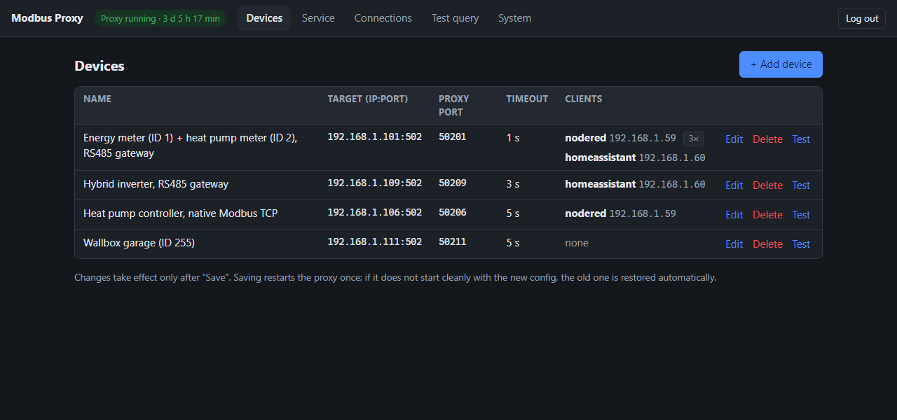
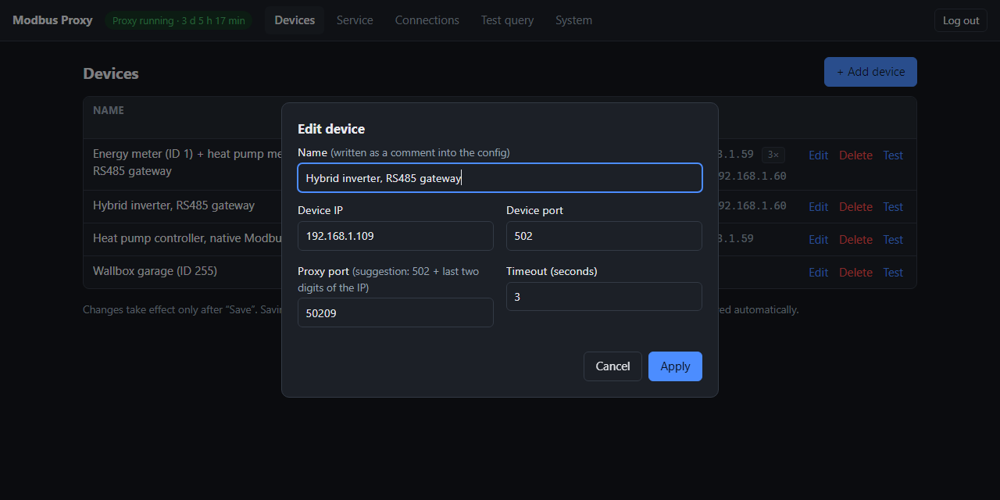
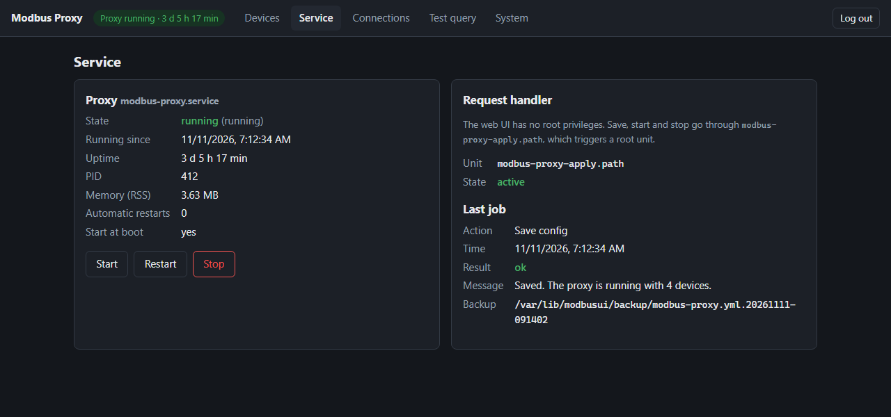
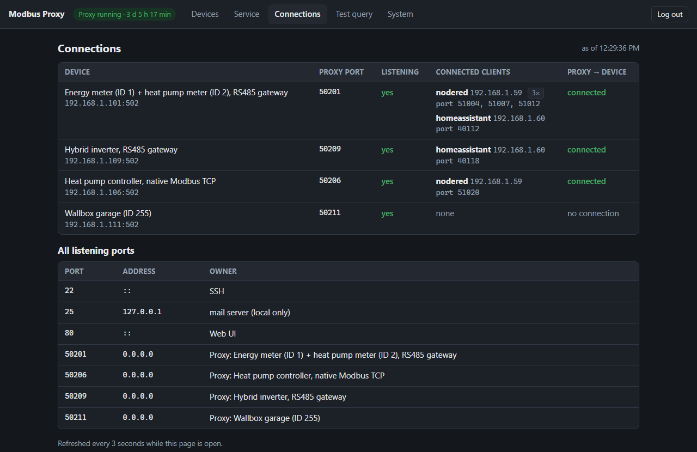
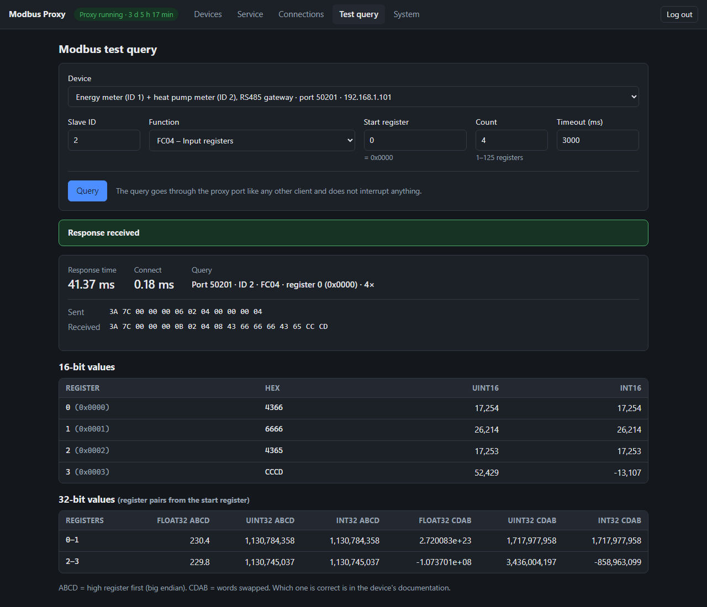
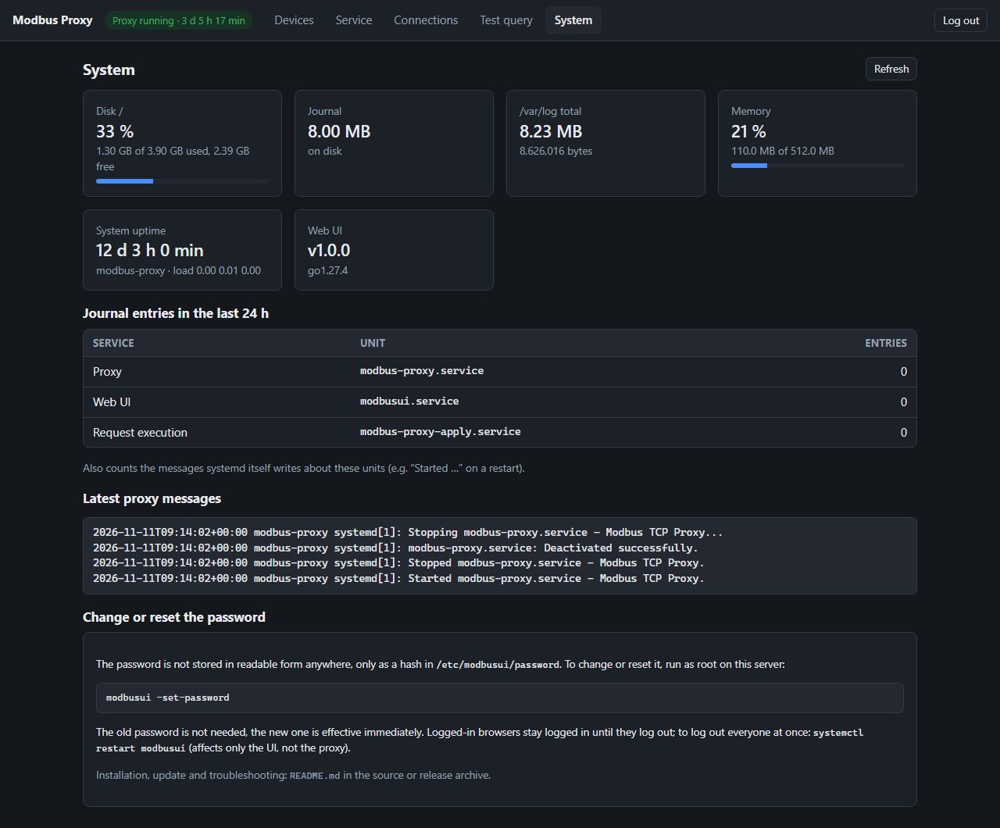

# modbusui – web UI for modbus-proxy-rs

A small, self-contained web UI to manage [modbus-proxy-rs](https://github.com/tiagocoutinho/modbus-proxy-rs) on a Linux server with systemd (e.g. a Debian LXC container on Proxmox, or a Raspberry Pi).

- **One binary**: Go standard library only, HTML/CSS/JS embedded. No third-party modules, builds offline.
- **Does not run as root**: privileges only via systemd features, no `sudo` required.
- **No logs**: in normal operation nothing is written to stdout/stderr or the journal.
- **Safe saving**: backup → replace config → restart proxy → automatic rollback if it fails to start.
- Ready-made binaries for **x86-64, ARM64 and ARMv7**, one-command installer.



**Contents**

1. [Features](#features)
2. [Screenshots](#screenshots)
3. [Quick start – install the ready-made release](#quick-start--install-the-ready-made-release)
4. [Operation](#operation)
5. [Building it yourself](#building-it-yourself)
6. [Reference](#reference) – how it works, security, config format, command line, API, code, tests

---

## Features

| Page | Content |
|---|---|
| **Devices** | All proxy entries with name, target (IP:port), proxy port, timeout and connected clients (with hostname). Add, edit, delete. Changes are collected and saved with one click (one restart). |
| **Service** | Status, uptime, PID, memory and automatic restarts of the proxy. Start / stop / restart. State of the request handler and the last job. |
| **Connections** | Per device: is the port listening, which clients are connected (hostname via reverse DNS, IP, number of connections, source ports), is there a connection from the proxy to the device. All listening ports. Refreshed every 3 s. |
| **Test query** | Modbus TCP query through a proxy port: slave ID, FC03/FC04, start register (decimal or hex), count. Result: raw bytes, response time, values as uint16/int16 and uint32/int32/float32 in both word orders (ABCD/CDAB), Modbus exception codes in plain text. |
| **System** | Disk space, journal size, `/var/log`, memory, uptime, journal entries of the last 24 h per unit, latest proxy messages, password hint. |

**Checks when saving** (in the browser and again on the server):
- name present, no control characters, max. 100 characters
- device IP is a valid IPv4 address (no loopback/multicast/broadcast)
- device port 1–65535, timeout 1–60 s (whole seconds)
- proxy port 1024–65535, not used twice, not used by another program
- no target (IP:port) used twice
- the config has not been changed by someone else since it was loaded
- without a change the proxy is **not** restarted

The proxy port suggestion is `502` + the last two digits of the device IP (`.109` → `50209`); it can be overridden.

---

## Screenshots

All screenshots show sample data in the dark theme; the UI follows the light/dark setting of the browser. Click an image for the full size.

| | |
|---|---|
| **Devices** – list with connected clients | **Edit device** – with live validation |
| [](docs/screenshots/devices.png) | [](docs/screenshots/devices-edit.png) |
| **Service** – status, start / stop / restart, last job | **Connections** – clients with hostnames, listening ports |
| [](docs/screenshots/service.png) | [](docs/screenshots/connections.png) |
| **Test query** – Modbus FC03/FC04 with decoded values | **System** – disk, journal, memory, password hint |
| [](docs/screenshots/test-query.png) | [](docs/screenshots/system.png) |
| **Login** | |
| [](docs/screenshots/login.png) | |

---

## Quick start – install the ready-made release

### Requirements

| What | Check with | Expected |
|---|---|---|
| Linux with systemd | `systemctl --version` | tested with systemd 257 (Debian 13) |
| modbus-proxy-rs as a service | `systemctl is-active modbus-proxy` | `active` |
| Proxy config | `cat /etc/modbus-proxy.yml` | format as in [Config format](#config-format) |
| D-Bus system bus | `ls /run/dbus/system_bus_socket` | file exists |
| Architecture | `uname -m` | `x86_64`, `aarch64` or `armv7l` |

The service must be called `modbus-proxy.service` and read `/etc/modbus-proxy.yml`. Other names can be set with [command line options](#command-line) in the unit files.

### Install

As root on the server. Pick the archive for your architecture from the **Releases** page:

| `uname -m` | Archive |
|---|---|
| `x86_64` | `modbusui-<version>-linux-amd64.tar.gz` |
| `aarch64` | `modbusui-<version>-linux-arm64.tar.gz` |
| `armv7l` | `modbusui-<version>-linux-armv7.tar.gz` |

```bash
cd /tmp
curl -fsSLO https://github.com/labmaster/modbus-proxy-rs-ui/releases/download/v<version>/modbusui-<version>-linux-amd64.tar.gz
tar -xzf modbusui-<version>-linux-amd64.tar.gz
cd modbusui-<version>-linux-amd64
sh install.sh
```

`install.sh` does everything:
1. checks the system and the architecture,
2. installs the binary to `/usr/local/bin/modbusui`,
3. creates the system user `modbusui` (no login, no home directory),
4. creates `/var/lib/modbusui/{spool,result,backup}`,
5. installs the three systemd units,
6. asks for the login password (first installation only),
7. starts the UI and enables it at boot.

At the end it prints the address, e.g. `modbusui is running: http://192.168.1.57/`. **The proxy is not restarted.**

Options:

```bash
sh install.sh --port 8080     # different port for the web UI (default 80)
sh install.sh --uninstall     # remove the UI, keep config backups
sh install.sh --purge         # remove the UI including config backups
```

### First login

Open the address in the browser, log in with the password from the installation and check:
- **Devices**: all entries of the config are listed with their names.
- **Service**: proxy “running”, request handler “active”.
- **System**: journal counts are shown (not “error”).
- **Test query**: query a known register of a device.

### Update

Download the new archive, unpack it and run `sh install.sh` again. The password, the port and the backups are kept; only the UI is restarted (log in again afterwards), the proxy is not.

---

## Operation

### Changing devices

1. Page **Devices** → “+ Add device”, “Edit” or “Delete”. Changes are highlighted (new / changed) and a save bar appears at the bottom.
2. **Save & restart proxy** → confirm. A window shows the progress:
   - **green** – saved, the proxy is running with the new config.
   - **yellow** – the new config failed to start, the old one was **restored automatically**; the reason is shown. Your input is kept so you can fix it.
   - **red** – error, read the message (page “Service” shows the last job).

Saving restarts the proxy **once**; connected clients are disconnected briefly and reconnect. So collect several changes and save once. Without a change nothing is restarted.

### Service control

Page **Service** → Start / Restart / Stop. **Stop** disconnects all clients until the proxy is started again.

### Test query

Pick a device, enter slave ID, function (FC03 holding / FC04 input registers), start register and count → **Query**. The query goes through the proxy port like any other client and does not interrupt anything. For 32-bit values both word orders are shown; which one is right is in the device documentation (ABCD = high register first).

### Change or reset the password

```bash
modbusui -set-password          # as root on the server
```
The old password is not needed, the new one is effective immediately. Logged-in browsers stay logged in; to log out everyone at once: `systemctl restart modbusui` (affects only the UI). The hint is also on the login page and on the “System” page. The password is not stored in readable form anywhere.

### Backups and manual restore

Before every save the old config is backed up; the last 20 are kept:
```bash
ls -l /var/lib/modbusui/backup/
diff /var/lib/modbusui/backup/modbus-proxy.yml.<DATE-TIME> /etc/modbus-proxy.yml
```
Restore an older version by hand:
```bash
cp /var/lib/modbusui/backup/modbus-proxy.yml.<DATE-TIME> /etc/modbus-proxy.yml
systemctl restart modbus-proxy
```
Then reload the “Devices” page.

### What ends up in the journal?

The UI and the request executor write nothing (`StandardOutput=null`, `StandardError=null`, `LogLevelMax=notice` – this also filters systemd's own “Started …” messages). What remains:
- one line “Started modbus-proxy-apply.path” per boot,
- on save/restart the usual 3–4 systemd lines of the proxy service,
- error messages of the proxy itself (depending on its `RUST_LOG`), e.g. when a test query hits an unreachable device.

Check: page **System** or `journalctl -u modbusui -u modbus-proxy-apply -u modbus-proxy --since -24h`.

### Troubleshooting

| Problem | Cause / check |
|---|---|
| Page not reachable | `systemctl status modbusui`; see the error: `systemctl stop modbusui; runuser -u modbusui -- /usr/local/bin/modbusui -listen :8080` (Ctrl+C ends it, then `systemctl start modbusui`) |
| Login: “No password has been set yet” | `modbusui -set-password` |
| Login: “Too many failed attempts” | wait one minute |
| Saving hangs at “Waiting to be executed” | `systemctl status modbus-proxy-apply.path` – must be `active` |
| “Saving is blocked” | the config contains settings the UI does not know (message on the “Devices” page) – see [Config format](#config-format) |
| “The config has been changed in the meantime” | someone edited the file by hand – reload the page |
| No hostnames for clients | reverse DNS: `getent hosts <client-ip>` |
| Journal counts show “error” | user `modbusui` needs the group `systemd-journal` (set in the unit as `SupplementaryGroups=`) |
| Result of the last job | `cat /var/lib/modbusui/result/status.json` |

### Uninstall

```bash
sh install.sh --uninstall     # or --purge to delete the config backups too
```
Removes the binary, the units, the user, the password and the working directories. The proxy and `/etc/modbus-proxy.yml` are not touched.

---

## Building it yourself

Everything needed is in the repository: `build.sh` / `build.ps1` build the release archives, `install.sh` also installs straight from the source tree.

### Option 1 – build and install on the server

Install Go (official archive, no package manager, no dependencies; Go 1.24 or newer, current version and checksum on https://go.dev/dl/):

```bash
cd /tmp
V=go1.27.4
ARCH=amd64          # arm64 or armv6l for ARM
curl -fsSLO https://go.dev/dl/$V.linux-$ARCH.tar.gz
sha256sum $V.linux-$ARCH.tar.gz          # compare with go.dev/dl
rm -rf /usr/local/go && tar -C /usr/local -xzf $V.linux-$ARCH.tar.gz && rm $V.linux-$ARCH.tar.gz
/usr/local/go/bin/go version
```
Go uses about 280 MB, starts no service and writes no logs; it may stay installed.

Get the source and install:
```bash
git clone https://github.com/labmaster/modbus-proxy-rs-ui.git /usr/local/src/modbusui
cd /usr/local/src/modbusui
sh install.sh
```
In the source tree `install.sh` always builds from the current source when Go is installed (`GOPROXY=off`, so nothing is downloaded). Without Go it falls back to `dist/modbusui-linux-<arch>` from `build.sh`.

**Quick source changes** – edit, then:
```bash
cd /usr/local/src/modbusui
/usr/local/go/bin/go test ./...
sh install.sh          # rebuilds and restarts only the UI
```
The web files (`web/`) are embedded into the binary, so after changing them a rebuild is needed too.

### Option 2 – build the release archives on a PC

Install Go from https://go.dev/dl/, then in the project folder:

```bash
sh build.sh            # Linux, macOS, Git Bash
sh build.sh 1.2.0      # with an explicit version
```
```powershell
powershell -ExecutionPolicy Bypass -File build.ps1          # Windows
```

Result in `dist/`:

| File | For |
|---|---|
| `modbusui-<version>-linux-amd64.tar.gz` | x86-64 |
| `modbusui-<version>-linux-arm64.tar.gz` | ARM 64-bit (e.g. Raspberry Pi 3/4/5 with 64-bit OS) |
| `modbusui-<version>-linux-armv7.tar.gz` | ARM 32-bit (e.g. Raspberry Pi 2/3/4 with 32-bit OS) |
| `modbusui-linux-<arch>` | plain binaries (used by `install.sh` in the source tree) |
| `SHA256SUMS` | checksums |

Each archive contains the binary, `install.sh`, `deploy/`, `README.md` and `LICENSE` – copy it to the server and install as in the [quick start](#install). These archives are what goes onto the GitHub Releases page.

---

## Reference

### How it works and security model

```
browser ──HTTP──▶ modbusui (user modbusui, port 80)
                     │  reads: /etc/modbus-proxy.yml, /proc/net/tcp*, systemctl show, journalctl
                     │  writes ONLY: /var/lib/modbusui/spool/request.json
                     ▼
        modbus-proxy-apply.path   (systemd notices the request file)
                     ▼
        modbus-proxy-apply.service → modbusui -apply   (root, oneshot)
                     │  validates again, backup, replaces the config atomically,
                     │  systemctl restart modbus-proxy, health check,
                     │  on failure: restore backup + restart
                     ▼
        /var/lib/modbusui/result/status.json  ──▶  the UI shows the result
```

| Path | Owner | Purpose |
|---|---|---|
| `/usr/local/bin/modbusui` | root | the program (UI, executor and password tool) |
| `/etc/modbusui/password` | root:modbusui 640 | password hash |
| `/var/lib/modbusui/spool/` | modbusui 700 | the UI places jobs here (the only place it may write) |
| `/var/lib/modbusui/result/` | root 755 | the executor writes the result here |
| `/var/lib/modbusui/backup/` | root 755 | the last 20 versions of `/etc/modbus-proxy.yml` |

| Unit | Task |
|---|---|
| `modbusui.service` | the web UI, as user `modbusui` |
| `modbus-proxy-apply.path` | watches `spool/request.json` and starts … |
| `modbus-proxy-apply.service` | … `modbusui -apply` as root |

- The UI has **no** root privileges. It may only write to its spool directory (`ProtectSystem=strict`, `ReadWritePaths=`). For port 80 it gets nothing but `CAP_NET_BIND_SERVICE`.
- The root part reads the job without following symlinks (`O_NOFOLLOW`), deletes it at once, validates all values **itself** again and generates the YAML file itself. YAML is never taken over from the unprivileged part.
- Allowed jobs: `apply` (new device list), `start`, `stop`, `restart`. Nothing else.
- **Health check** after the restart: service `active/running`, all proxy ports listening, and that for 2 s with the same PID. Otherwise rollback (check takes max. 12 s).

**Login**
- One password, stored only as a hash (PBKDF2-SHA256, 600,000 iterations, random salt).
- Sessions in memory only, cookie `HttpOnly`, `SameSite=Strict`, expires after 12 h of inactivity; restarting the UI logs everyone out.
- Writing requests need the header `X-Modbusui: 1` (CSRF protection).
- Throttling: blocked after 5 failed attempts per minute, every failed attempt takes 1 s.
- Meant for use **inside the LAN**. There is no HTTPS – do not expose it to the internet.

### Config format

The UI understands exactly this format of `modbus-proxy-rs`. The comment line above an entry is the device name and is kept when saving; comment lines before `devices:` are kept as well.

```yaml
devices:
# Inverter, RS485 gateway in Modbus TCP mode
- modbus:
    url: 192.168.1.109:502
    timeout: 3
  listen:
    bind: 0:50209
```

If the file contains other settings (further modbus-proxy-rs options, fractional timeouts, a `bind` address other than `0`), the UI only shows it and **blocks saving**, so that nothing gets lost.

### Command line

```
modbusui                  start the web UI
modbusui -apply           execute the job in the spool (root, called by systemd)
modbusui -set-password    set the login password (root)
modbusui -version         print the version

  -listen :80                               address of the web UI
  -proxy-config /etc/modbus-proxy.yml       proxy config file
  -proxy-unit modbus-proxy.service          systemd unit of the proxy
  -apply-path-unit modbus-proxy-apply.path  path unit (only for the status display)
  -state-dir /var/lib/modbusui              spool/, result/, backup/
  -password-file /etc/modbusui/password     password hash
```

With these options a second, independent instance can run next to the first one (see tests).

### API (internal, used by the web page)

| Method | Path | Purpose |
|---|---|---|
| GET | `/api/session` | logged in? password set? |
| POST | `/api/login`, `/api/logout` | log in / log out |
| GET / POST | `/api/devices` | read / save the device list (returns a job ID) |
| GET / DELETE | `/api/job?id=…` | job status / withdraw a job while it is still queued |
| GET / POST | `/api/service` | service status / `start`, `stop`, `restart` |
| GET | `/api/connections` | ports, clients with hostnames, connections to the devices |
| POST | `/api/modbus` | test query (only proxy ports from the config) |
| GET | `/api/system` | system values |

All paths except `/api/session` and `/api/login` need a valid session; writing requests also need the header `X-Modbusui: 1`.

### Code

```
.
├── main.go          entry point, flags, modes
├── server.go        HTTP server, API, login check
├── auth.go          password hash, sessions, -set-password
├── config.go        parser/writer for modbus-proxy.yml, validation
├── apply.go         root part: backup, replace, restart, rollback
├── spool.go         job and status files
├── service.go       systemctl / journalctl
├── sockets.go       reading /proc/net/tcp(6)
├── hostnames.go     reverse DNS with cache
├── modbus.go        Modbus TCP test query
├── sysinfo.go       system values
├── sys_linux.go     Linux specific (statfs, O_NOFOLLOW …)
├── sys_other.go     stubs so it also builds on Windows/macOS
├── config_test.go   unit tests
├── web/             index.html, style.css, app.js (embedded)
├── deploy/          systemd units; test/ = test instance and automatic test
├── docs/            screenshots for this README
├── install.sh       installer (release archive or source tree)
├── build.sh         builds the release archives (Linux/macOS/Git Bash) …
├── build.ps1        … the same for Windows PowerShell
└── tools/release/   … both call this Go tool: cross-builds, packs (owner root, fixed permissions), checksums
```

The web page (`web/`) is plain HTML/CSS/JavaScript without a framework.

### Tests

**Unit tests** (no server needed, also on Windows): `go test ./...`

**Full test on the server without touching the real proxy:** `deploy/test/` contains a complete test instance – a second proxy (ports 50291/50292, targets in the documentation network 192.0.2.0/24, so no real device is contacted), a test UI on port 8081 and its own request handler. `modbus-proxy-test.service` refuses to start if a device is named `FAILTEST` – this triggers the rollback on purpose. `ui-test.py` checks login, reading, validation, saving, rollback, start/stop and finally that the real proxy still has the same PID and start time as before.

```bash
cd /usr/local/src/modbusui          # or the unpacked release archive
sh deploy/test/setup.sh             # set up the test instance
python3 -I deploy/test/ui-test.py   # expected: "… of … checks passed." with all OK
sh deploy/test/teardown.sh          # remove everything again
```
While it runs, the test UI is at `http://<server-ip>:8081/` (password in `/root/modbusui-test-pw.txt`). Requires `modbus-proxy-rs` in `/usr/local/bin`, the user `modbusproxy` and `python3`.

---

## License

MIT – see [LICENSE](LICENSE).
